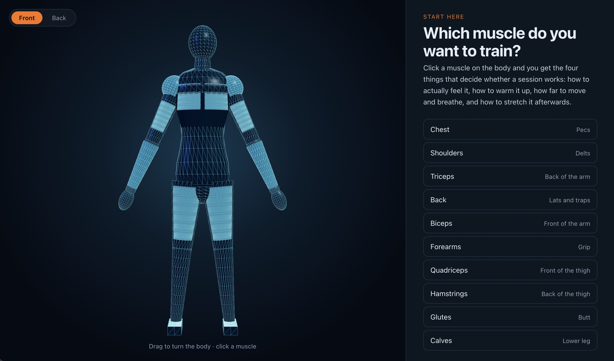

# Fitness Coach

Beginner gym-goers often struggle to find clear and reliable guidance when training a specific muscle group.This project shows that a transparent, rule-based NLP pipeline can turn long, unstructured YouTube coaching videos into short, beginner-friendly exercise guidance that users can trace back to its source. Beginner gym-goers often turn to YouTube for help, but the useful advice is buried inside long videos and scattered across many creators.



**Live demo:** https://fitnesscoach-flax.vercel.app/

## Muscles

Chest, Shoulders, Triceps, Back, Biceps, Forearms, Quadriceps, Hamstrings,
Glutes, Calves.

## The pipeline

Everything the app shows about exercises is extracted from real coaching
videos, not written by us. `pipeline/` turns those videos into the data the
app reads, one stage at a time.

| Stage                            | What it does                                                                                                                                                             |
| -------------------------------- | ------------------------------------------------------------------------------------------------------------------------------------------------------------------------ |
| `01_acquire.py`                  | Downloads transcripts and chapter markers for 110 curated coaching videos.                                                                                               |
| `02_clean.py`                    | Repairs the transcripts: removes `[Music]` tags, fixes misheard gym terms, and restores punctuation so the text can be split into sentences.                             |
| `03_exercises.py`                | Finds the exercises. Builds a vocabulary from the chapter titles creators write, then counts how often each exercise is discussed and works out what equipment it needs. |
| `03b_baseline.py`                | A deliberately naive version of stage 03, used as a comparison point.                                                                                                    |
| `04_llm_extract.py`              | Asks a language model to extract the same information, as a second opinion.                                                                                              |
| `05_compare.py`, `06_metrics.py` | Measure how the three approaches compare.                                                                                                                                |

Each stage writes to its own folder, so nothing is overwritten and any step can
be re-run on its own:

```
data/01_raw/        raw transcripts
data/02_clean/      cleaned, 108 transcripts · 290k words · 16k sentences
data/03_exercises/  165 exercises with tier and equipment
data/05_comparison/ evaluation results
```
